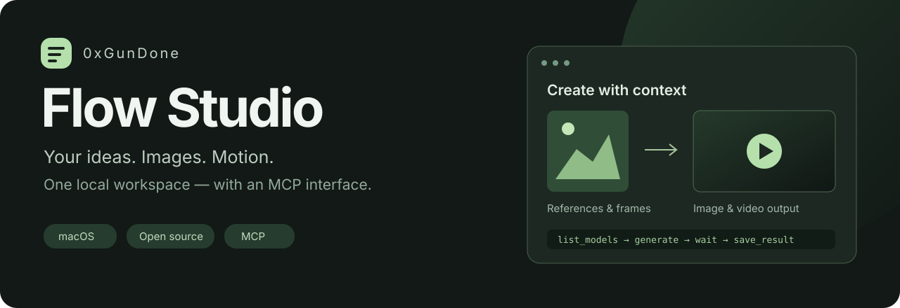

<p align="center">
  
</p>

<p align="center">
  <strong>A macOS desktop workspace for Google Flow.</strong><br>
  Generate images and video, manage accounts, save results, and use the same workflow through MCP.
</p>

<p align="center">
  <a href="https://github.com/0xGunDone/flow-studio/releases/tag/v1.0.0">Download for macOS</a> ·
  <a href="https://github.com/0xGunDone/flow-studio/releases">All releases</a> ·
  <a href="docs/mcp.md">MCP guide</a> ·
  <a href="README.md">Русский</a>
</p>

> **Alpha release.** Supports macOS on Apple Silicon and Intel. Builds have no Apple Developer ID signature or notarization. Generation availability depends on Google Flow, your account, and the selected model.

## Included

- Text-to-image, editing and image references, subject to each model's limits.
- Text-to-video, reference-guided video, start/end frames, and video extension on supported models.
- Multiple Google accounts with separate managed Chrome profiles and explicit reauthentication.
- Local previews, export, Finder integration, and the latest 100 jobs in persistent history.
- A local MCP server exposing 13 tools for models, jobs, media, and accounts.
- Bundled Flow2API source, built into a local Docker image on first launch.

The interface and history run locally. Generation runs on Google's services and may spend your Google Flow credits. Prompts, input images, and session data are sent to the service. A model appearing in the catalog does not guarantee access under your plan.

## Install

Prerequisites: **Google Chrome** and **Docker Desktop**, or **Colima with Docker CLI and Docker Compose**. The desktop app does not require host Node.js or Python. MCP requires Node.js 22 or later.

1. Install Chrome and start your Docker environment.
2. Download the matching asset from [Releases](https://github.com/0xGunDone/flow-studio/releases/tag/v1.0.0): `arm64` for Apple Silicon or `x64` for Intel.
3. Move `Flow Studio.app` to `Applications` and open it. If macOS blocks this unsigned build, review it in **System Settings → Privacy & Security** and use the normal macOS approval flow only if you trust the download.
4. Wait for the first Docker build. This downloads dependencies and needs internet access and free disk space.
5. Open **Аккаунты → Войти в Google**. Sign in inside the Chrome window, open Flow, return to the app, and choose **Я вошёл**.
6. Open **Создать**, choose a model, enter a prompt, and generate. Export results with **Сохранить как…**.

The interface and detailed guides are currently in Russian. The app creates local server credentials automatically. The optional Chrome extension is not required for the normal sign-in flow.

## MCP

```bash
git clone https://github.com/0xGunDone/flow-studio.git
cd flow-studio
npm ci --prefix app
```

Configure a `stdio` MCP server with an absolute script path:

```json
{
  "mcpServers": {
    "flow-studio": {
      "command": "node",
      "args": ["/absolute/path/flow-studio/app/mcp-server.cjs"]
    }
  }
}
```

Open Flow Studio before the first call. Use `flow_studio_status`, read `flow_studio_list_models`, then generate, wait, and save. Each new generation requires a stable `requestId` and user authorization to spend credits. The bridge and app share accounts and jobs; do not start a separate backend for MCP. See [MCP tools and examples](docs/mcp.md).

## Develop

```bash
npm ci --prefix app
npm start --prefix app
npm test --prefix app
```

[Build instructions](docs/development.md) · [Troubleshooting](docs/troubleshooting.md) · [Contributing](CONTRIBUTING.md)

## Limits and data

Data lives in `~/Library/Application Support/Flow Studio`, including session material. Do not upload this directory. The backend binds to `127.0.0.1:38000`; MCP uses a separate authenticated loopback bridge. One generation runs at a time. Cancellation or quitting the app does not guarantee that Google stops a request or refunds credits. Check Flow before retrying an uncertain job.

Windows and Linux are not supported by this desktop release. Model access, credits, session expiry, and upstream service changes can affect generation.

## Credits and license

Built on [Flow2API](https://github.com/TheSmallHanCat/flow2api) by TheSmallHanCat, based on commit `f6f201c298ee6ee4b28a7d36adf3a8d49cfb2844` with local changes. Its original [MIT license](backend/LICENSE) is preserved.

Flow Studio is independent and is not an official Google product. [MIT license](LICENSE) · [Third-party notices](THIRD_PARTY_NOTICES.md) · [Security policy](SECURITY.md)
