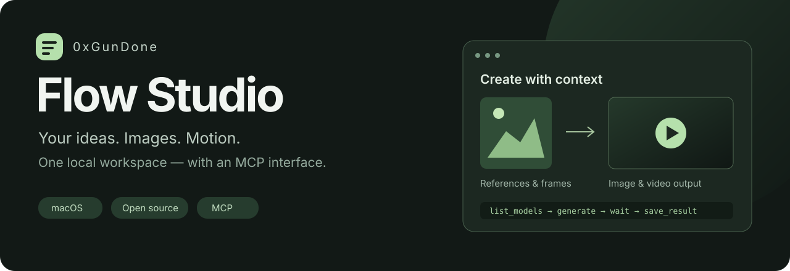

<p align="center">
  
</p>

<p align="center">
  <strong>A macOS desktop workspace for Google Flow.</strong><br>
  Generate images and video, manage accounts, save results, and use the same workflow through MCP.
</p>

<p align="center">
  <a href="https://github.com/0xGunDone/flow-studio/releases">Download for macOS</a> ·
  <a href="https://github.com/0xGunDone/flow-studio/releases">All releases</a> ·
  <a href="docs/mcp.md">MCP guide</a> ·
  <a href="README.md">Русский</a>
</p>

> **Alpha release.** Supports macOS on Apple Silicon and Intel. Builds have no Apple Developer ID signature or notarization. Generation availability depends on Google Flow, your account, and the selected model.

## Included

- Text-to-image, editing and image references, subject to each model's limits.
- Separate video methods for text, Frames, Ingredients, editing, and extension, with independent model, duration, aspect ratio, and available resolution controls.
- Automatic isolated background generation for supported Nano Banana images, Omni 1.2 Flash video modes, and standard Veo 3.1 variants, leaving your regular Chrome available. Omni keeps up to seven image ingredients and explicit start/end frame roles; Edit uses one source video with optional images.
- Dedicated start and end frame slots with Finder drag and drop or file selection; a separate ingredient list with previews, arrow controls, and individual removal.
- Multiple Google accounts with separate managed Chrome profiles and explicit reauthentication.
- Local previews, export, Finder integration, and the latest 100 jobs in persistent history, with submitting account identity and manual replay from cached inputs.
- A persistent 30-minute account cooldown after attributed failures, countdown and last error, with local reset controls; Google restrictions remain in force.
- MCP API 3 with 24 tools for model discovery, local preparation, generation, files, accounts, and diagnostics.
- Bundled Flow2API source, built into a local Docker image on first launch.

Supported **Nano Banana**, **Omni 1.2 Flash**, and standard **Veo 3.1** models use Flow Studio’s own background browser. This route needs no desktop focus, Accessibility, or Screen Recording permission. Sign in through the app once; the managed profile persists. If an account reports `browserReady:false`, use **Войти заново** (Reconnect). **Настройки → Фоновая генерация** checks its login and project without generating video.

On the first image upload, Google may ask for “Rights to use this image”. Flow Studio shows Google’s terms and the account in its own dialog. The user decides; cancel stops the upload. The app never accepts these terms automatically. Upload consent does not click Generate or authorize credit spend.

Choose one account in the editor or leave **Автоматически** (Automatic). The chosen account stays pinned to the job; failures never rotate accounts or fall back to another engine. Omni 1.2 Edit uses Flow Agent in the same app-owned browser, preserving the exact account, model, prompt, source video and image order. Agent prepares one proposal for one video. Before one Approve action, the app verifies the proposal, persists its private receipt and crosses the same authorized-spend boundary; there is no automatic reapproval, account rotation or paid fallback. Extension and unsupported variants keep their existing server route, reported as `generationEngine` in MCP.

Result verification now uses one selected semantic History entry: full prompt text is compared exactly, with ordered references and output poster from that same entry. The tuple is rechecked before download, and menus must belong to the entry’s own button through aria-controls. Missing, ambiguous or changed bindings fail closed. Read-only downloads of an existing two-reference image and Veo 720p video, plus original receipt-based recovery, were verified without another generation. The installed-app Omni 1.2 Edit pipeline through Flow Agent is verified with a source video and two distinct images in exact order: original prompt, one proposal, one Approve for 36 credits, waiting, bound-History verification, download and save without manual recovery. The job completed in 279 seconds; the MP4 is 720×1280, 9:16, H.264/AAC, 10.026667 seconds. Separate no-image-reference and two-image jobs also passed receipt recovery without another generation. These checks cover the stated portrait 720p case; other aspects/durations and successful 360p Edit are not claimed verified.

The interface and history run locally. Generation runs on Google's services and may spend your Google Flow credits. Prompts, input images/videos, and session data are sent to the service. A model appearing in the catalog does not guarantee access under your plan.

Omni Edit accepts MP4, MOV, or M4V up to 100 MiB: a source can last up to 15 seconds for Omni 1.2 or 10 seconds for Omni 1.1. Output duration follows the source video. Add one video and up to five images; the app uploads the video itself without extracting frames.

Settings offer combinations present in the current catalog. Frames use the dedicated **Начальный кадр** (start frame) slot and optional **Конечный кадр** (end frame) slot; drop an image or use the button in each slot. Ingredients guide the content or style. Switching methods preserves frame files and ingredient files separately; a request uses the selected method's inputs.

For a new video without a chosen model, **Omni 1.2 Flash** is preferred when compatible with the current catalog. Saved or explicit choices, history, and prepared requests keep their model. If compatible Omni 1.2 is absent, choose a model explicitly; there is no automatic fallback to Omni 1.1.

Omni 1.2 offers text, ingredients, and frames from 3 through 15 seconds, 16:9 and 9:16, and 720p (`standard`) or 360p. Frames require a start frame; an end frame is optional from 3 through 10 seconds, while 11–15 seconds accept only a start frame. Durations from 11 through 15 seconds require Google AI Pro or Ultra.

The current Veo catalog requires Google AI Ultra for 4- and 6-second variants; Pro users should choose an available 8-second variant. Eight-second frame models are available for Lite, Fast, and Quality. Check the current catalog and Google's [model feature table](https://support.google.com/flow/answer/16352836) and [frames and references guide](https://support.google.com/flow/answer/16353334) as availability changes.

Nano Banana 2.1 and Pro use explicit Flow download upscales for 2K/4K; Lite stays standard-only. An existing Nano Banana 2.1 portrait 2K Upscaled download was verified at 1536×2752 versus standard 768×1376, without another generation. Other families, aspects, and 4K remain unverified.

## Install

Prerequisites: **Google Chrome** and **Docker Desktop**, or **Colima with Docker CLI and Docker Compose**. The desktop app does not require host Node.js, Python, or FFmpeg: video validation uses `ffprobe` inside the container. MCP requires Node.js 22.12 or later.

1. Install Chrome and start your Docker environment.
2. Download the matching asset from [Releases](https://github.com/0xGunDone/flow-studio/releases): `arm64` for Apple Silicon or `x64` for Intel.
3. Move `Flow Studio.app` to `Applications` and open it. If macOS blocks this unsigned build, review it in **System Settings → Privacy & Security** and use the normal macOS approval flow only if you trust the download.
4. Wait for the first Docker build. This downloads dependencies and needs internet access and free disk space.
5. Open **Аккаунты → Войти в Google**. Sign in inside the Chrome window, open Flow, return to the app, and choose **Я вошёл**.
6. Open **Создать**, choose the output type and video method if needed, then select a model and its available settings. Enter a prompt, add the required inputs, and generate. Export results with **Сохранить как…**.

The interface and detailed guides are currently in Russian. The app creates local server credentials automatically. The optional Chrome extension is not required for the normal sign-in flow.

The local engine runs while Flow Studio is open. Closing its window with × or quitting with `⌘Q` exits the app and stops its engine and owned background browser. Minimizing the window keeps the app open. Google may continue an accepted generation after exit; check its result in Flow before retrying.

## MCP

The release MCP ZIP includes the adapter, lockfile, and complete `skills/flow-studio/` agent skill. Keep it outside a cloud-synced folder when needed; see the [MCP guide](docs/mcp.md) for connection and skill installation.

```bash
git clone https://github.com/0xGunDone/flow-studio.git
cd flow-studio
npm ci --prefix app
```

Configure a `stdio` MCP server with an absolute script path:

```json
{
  "mcpServers": {
    "flow-studio": {
      "command": "node",
      "args": ["/absolute/path/flow-studio/app/mcp-server.cjs"]
    }
  }
}
```

Open Flow Studio before the first call. Use `flow_studio_status`, read `flow_studio_list_models`, then generate, wait, and save. Each new generation requires a stable `requestId` and user authorization to spend credits. The bridge can launch the installed app when needed and shares its accounts and jobs. The MCP server does not keep the engine running after the app exits; do not start a separate backend for MCP. See [MCP tools and examples](docs/mcp.md).

## Develop

```bash
npm ci --prefix app
npm start --prefix app
npm test --prefix app
```

[Build instructions](docs/development.md) · [Troubleshooting](docs/troubleshooting.md) · [Contributing](CONTRIBUTING.md)

## Limits and data

Data lives in `~/Library/Application Support/Flow Studio`, including session material. Do not upload this directory. The backend binds to `127.0.0.1:38000`; MCP uses a separate authenticated loopback bridge. One generation runs at a time. Cancellation or quitting the app does not guarantee that Google stops a request or refunds credits. Check Flow before retrying an uncertain job.

Windows and Linux are not supported by this desktop release. Model access, credits, session expiry, and upstream service changes can affect generation.

## Credits and license

Built on [Flow2API](https://github.com/TheSmallHanCat/flow2api) by TheSmallHanCat, based on commit `f6f201c298ee6ee4b28a7d36adf3a8d49cfb2844` with local changes. Its original [MIT license](backend/LICENSE) is preserved.

Flow Studio is independent and is not an official Google product. [MIT license](LICENSE) · [Third-party notices](THIRD_PARTY_NOTICES.md) · [Security policy](SECURITY.md)
