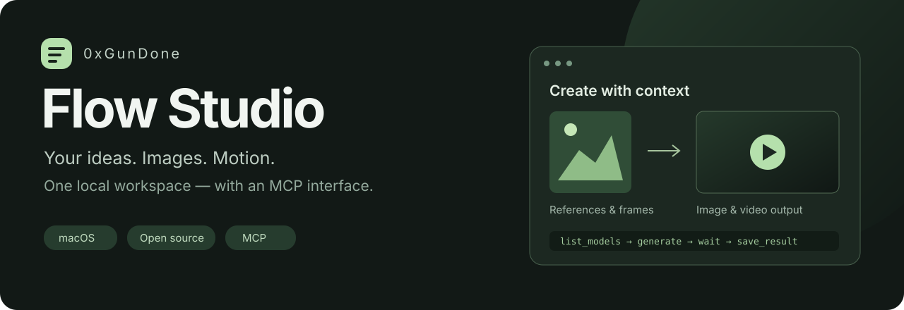

<p align="center">
  
</p>

<p align="center">
  <strong>Google Flow в отдельном приложении для macOS.</strong><br>
  Изображения, видео, аккаунты и история — в одном окне. Те же возможности доступны агентам через MCP.
</p>

<p align="center">
  <a href="https://github.com/0xGunDone/flow-studio/releases">Скачать для macOS</a> ·
  <a href="https://github.com/0xGunDone/flow-studio/releases">Все релизы</a> ·
  <a href="docs/getting-started.md">Первый запуск</a> ·
  <a href="docs/mcp.md">Подключить MCP</a> ·
  <a href="README.en.md">English</a>
</p>

> **Alpha.** Приложение предназначено для macOS с Apple Silicon или Intel. Доступность генерации зависит от Google Flow, вашего аккаунта и выбранной модели. Сборки не подписаны сертификатом Apple Developer ID и не нотарифицированы.

## Что можно делать

| Возможность | Как работает |
| --- | --- |
| Изображения | Запрос по тексту, редактирование и до пяти изображений-референсов с учетом лимита модели |
| Видео | Отдельный выбор режима: текст, Frames, Ingredients, редактирование или продолжение. Модель, длительность, формат и доступное разрешение выбираются отдельно |
| Фоновая генерация | Поддерживаемые Nano Banana, Omni 1.2 Flash и стандартные Veo 3.1 используют отдельный браузер приложения; обычный Chrome остается свободным |
| Исходные файлы | Отдельные области начального и конечного кадров с перетаскиванием из Finder. Общий список ингредиентов с предпросмотром, сменой порядка и удалением файлов |
| Несколько аккаунтов | Вход через Google Chrome, отдельный профиль для каждого аккаунта, проверка подключения и повторный вход |
| Результаты | Просмотр, «Сохранить как…», Finder, аккаунт отправки в истории и повтор с сохранёнными исходниками |
| Ошибки аккаунтов | Локальный КД на 30 минут, таймер, последняя ошибка и ручной сброс; ограничения Google сохраняются |
| MCP | API 3, 24 инструментов для каталога, подготовки, генерации, файлов, аккаунтов и диагностики |
| Локальный движок | Исходники Flow2API входят в приложение; контейнер собирается при первом запуске |

Поддерживаемые модели **Nano Banana**, **Omni 1.2 Flash** и стандартные **Veo 3.1** используют фоновый браузер Flow Studio без управления окнами, разрешений «Универсальный доступ» и «Запись экрана». После одного входа через приложение профиль сохраняется. Если аккаунт сообщает `browserReady:false`, нажмите **Войти заново** у него. В **Настройки → Фоновая генерация** можно проверить аккаунт и проект без создания видео.

При первой загрузке Google может запросить «Rights to use this image» или отдельное согласие на права исходного видео. Flow Studio показывает условия Google и аккаунт в собственном диалоге. Подтверждает пользователь; отмена останавливает загрузку. Согласие на права не нажимает Generate и не разрешает расход кредитов.

Аккаунт можно выбрать в редакторе или оставить **Автоматически**. Он фиксируется для задачи; ошибка не вызывает смену аккаунта или отправку через другой движок. Omni 1.2 Edit подключен к фоновому браузеру; связь исходного видео с записью результата и фактический вывод Edit еще проходят живую проверку. Продолжение и неподдерживаемые варианты сохраняют серверный маршрут; MCP показывает его в `generationEngine`.

Проверка результата использует одну выбранную семантическую запись History: полный текст запроса сравнивается точно, порядок референсов и постер берутся из той же записи. Перед скачиванием эти поля повторно проверяются, а меню открывается только через собственную кнопку выбранной записи и ее aria-controls. Отсутствующая, неоднозначная или изменившаяся связь отклоняется. Этот путь проверен без новой генерации на изображении с двумя референсами, Veo 720p и восстановлении исходной задачи по записи отправки. В установленном приложении проверен непрерывный проход Omni 1.2 Edit через Flow Agent с исходным видео и двумя разными изображениями в точном порядке: полный исходный запрос, одно предложение, одно Approve за 36 кредитов, ожидание, проверка History, скачивание и сохранение без ручного восстановления. Задача завершилась за 279 секунд; MP4 — 720×1280, 9:16, H.264/AAC, 10,026667 секунды. Отдельно проверены задачи без дополнительных изображений и с двумя изображениями, восстановленные по записям отправки без новой генерации. Эти проверки относятся к указанному портретному сценарию 720p; остальные форматы, длительности и успешный 360p Edit не заявлены проверенными.

Интерфейс и история работают локально. Сама генерация выполняется Google: запросы, исходные фото и видео, данные сессии передаются сервису. Генерация может расходовать кредиты Google Flow. Наличие модели в каталоге не подтверждает доступ к ней на вашем тарифе.

Omni 1.2 Edit использует Flow Agent в том же принадлежащем приложению браузере: точные аккаунт, модель, запрос, исходное видео и порядок изображений сохраняются. Agent готовит одно предложение на одно видео. Перед единственным Approve приложение проверяет предложение, сохраняет приватную запись отправки и проходит тот же барьер разрешенного расхода; повторного подтверждения, переключения аккаунта или платного fallback нет.

Для Omni Edit используйте MP4, MOV или M4V до 100 МиБ: Omni 1.2 принимает исходник до 15 секунд, Omni 1.1 — до 10 секунд. Длительность результата определяется исходным видео. Можно добавить одно видео и до пяти изображений; приложение загружает видео целиком, без извлечения кадров.

Настройки показывают сочетания из текущего каталога. Для Frames добавьте изображение в **Начальный кадр** и при необходимости в **Конечный кадр**; каждую область можно заполнить перетаскиванием или кнопкой. Ingredients задают содержание или стиль ролика. При смене режима файлы кадров и ингредиентов сохраняются раздельно.

Для нового видео без выбранной модели предпочтительна **Omni 1.2 Flash** из текущего каталога. Сохраненный или явный выбор, история и подготовленные запросы сохраняют свою модель. Если совместимой Omni 1.2 нет, выберите модель явно; автоматической замены на Omni 1.1 нет.

Omni 1.2 предлагает текст, ингредиенты и кадры на 3–15 секунд, форматы 16:9 и 9:16, разрешение 720p (`standard`) или 360p. В режиме Frames начальный кадр обязателен; конечный доступен на 3–10 секунд, а 11–15 секунд принимают только начальный. Длительности 11–15 секунд требуют Google AI Pro или Ultra.

В каталоге Veo варианты на 4 и 6 секунд требуют Google AI Ultra; для Pro выбирайте доступный вариант на 8 секунд. Режим «По кадрам» на 8 секунд есть у Lite, Fast и Quality. Возможности и доступ Google могут меняться: сверяйтесь с текущим каталогом и [официальной таблицей моделей](https://support.google.com/flow/answer/16352836). [Как Google различает кадры и образцы](https://support.google.com/flow/answer/16353334).

Nano Banana 2.1 и Pro используют явный upscale при скачивании 2K/4K; Lite остается в стандартном разрешении. Проверено скачивание существующего портретного Nano Banana 2.1 через 2K Upscaled: 1536×2752 против 768×1376, без новой генерации. Другие семейства, форматы и 4K еще не проверены.

## Установка

Понадобятся **Google Chrome** и работающий Docker: **Docker Desktop** либо **Colima + Docker CLI + Docker Compose**. Для готового приложения Node.js, Python и FFmpeg на Mac не нужны: проверка видео через `ffprobe` выполняется внутри контейнера. Для MCP потребуется Node.js 22.12 или новее.

1. Установите Chrome и выбранную среду Docker. Запустите Docker Desktop либо Colima.
2. Откройте [опубликованные релизы](https://github.com/0xGunDone/flow-studio/releases) и скачайте сборку для своего Mac: `arm64` для Apple Silicon, `x64` для Intel.
3. Перенесите `Flow Studio.app` в папку `Applications` и откройте приложение. Для неподписанной сборки используйте штатное разрешение macOS в разделе «Конфиденциальность и безопасность», если система блокирует запуск. Подробности — в [руководстве](docs/getting-started.md#если-macos-блокирует-запуск).
4. Дождитесь запуска движка. В первый раз Docker загружает зависимости и собирает локальный образ; требуется интернет и свободное место на диске.
5. Откройте **Аккаунты → Войти в Google**. В отдельном окне Chrome войдите в аккаунт, откройте Flow, затем вернитесь в приложение и нажмите **Я вошёл**.
6. В разделе **Создать** выберите тип результата, для видео — режим, затем модель и доступные настройки. Введите запрос, добавьте нужные исходники и запустите генерацию. Сохраните результат через **Сохранить как…**.

Не нужно вручную создавать API-ключ или пароль локального сервера. Приложение создает собственные локальные учетные данные при первом запуске. Для обычного входа расширение Chrome не требуется.

Локальный движок работает, пока открыто Flow Studio. Закрытие окна кнопкой × или выход через `⌘Q` завершает приложение и останавливает его движок и принадлежащий приложению фоновый браузер. Свернутое окно оставляет приложение открытым. Если генерация уже началась, Google может продолжить ее после выхода; проверьте результат в Flow перед повтором.

## MCP для агента

MCP ZIP из релиза содержит адаптер с lockfile и полный навык `skills/flow-studio/`. Его можно установить вне облачной папки; порядок подключения и установки навыка приведен в [руководстве MCP](docs/mcp.md).

MCP управляет тем же приложением, аккаунтами и историей. При необходимости мост запускает установленный Flow Studio; сам MCP-сервер не держит движок работающим после выхода из приложения. Второй backend запускать не нужно.

```bash
git clone https://github.com/0xGunDone/flow-studio.git
cd flow-studio
npm ci --prefix app
```

Укажите MCP-клиенту транспорт `stdio`, команду `node` и абсолютный путь к `app/mcp-server.cjs`:

```json
{
  "mcpServers": {
    "flow-studio": {
      "command": "node",
      "args": ["/absolute/path/flow-studio/app/mcp-server.cjs"]
    }
  }
}
```

Откройте Flow Studio перед первым вызовом. Для начала агент читает `flow_studio_status` и `flow_studio_list_models`, затем создает задачу, ожидает результат и сохраняет файл. [Полная настройка, список инструментов и примеры](docs/mcp.md).

## Работа из исходников

```bash
npm ci --prefix app
npm start --prefix app
```

Требования к Chrome и Docker остаются теми же. [Сборка приложения и проверка изменений](docs/development.md).

```text
app/        Electron-приложение, локальный мост и MCP-сервер
backend/    Flow2API и изменения для Flow Studio
extension/  Дополнительное расширение для синхронизации сессий
skills/     Инструкции для агента Flow Studio
docs/       Установка, MCP, разработка и диагностика
```

## Данные и ограничения

- Аккаунты, профили Chrome, история и рабочие файлы хранятся в `~/Library/Application Support/Flow Studio`. Папка содержит чувствительные данные сессий; не публикуйте ее и не прикладывайте целиком к issue.
- Backend по умолчанию доступен только локально на `127.0.0.1:38000`. MCP использует отдельный локальный мост со своим секретом.
- Приложение выполняет одну генерацию за раз. Длительность, разрешение и формат кадра определяет выбранная модель.
- При истечении сессии нужен повторный вход в Google. Повторный вход не запускает генерацию заново.
- Закрытие приложения или отмена ожидания не гарантируют отмену задачи у Google. Перед повтором проверьте ее результат в Flow.
- Windows и Linux не входят в поддерживаемые платформы desktop-релиза. У backend есть собственные сценарии запуска; они не означают поддержку desktop-приложения на этих системах.

Если что-то не работает, начните с [диагностики](docs/troubleshooting.md). Для сообщения об ошибке используйте [Issues](https://github.com/0xGunDone/flow-studio/issues); для чувствительных проблем — [политику безопасности](SECURITY.md).

## Основа проекта

Flow Studio использует [Flow2API](https://github.com/TheSmallHanCat/flow2api) от TheSmallHanCat. В репозиторий включена версия на основе коммита `f6f201c298ee6ee4b28a7d36adf3a8d49cfb2844` с локальными изменениями; оригинальная MIT-лицензия сохранена в [backend/LICENSE](backend/LICENSE).

Flow Studio — независимый проект, не официальный клиент Google. Google, Google Flow и Chrome принадлежат их правообладателям. Код распространяется по [MIT](LICENSE), сведения о сторонних компонентах — в [THIRD_PARTY_NOTICES.md](THIRD_PARTY_NOTICES.md).
